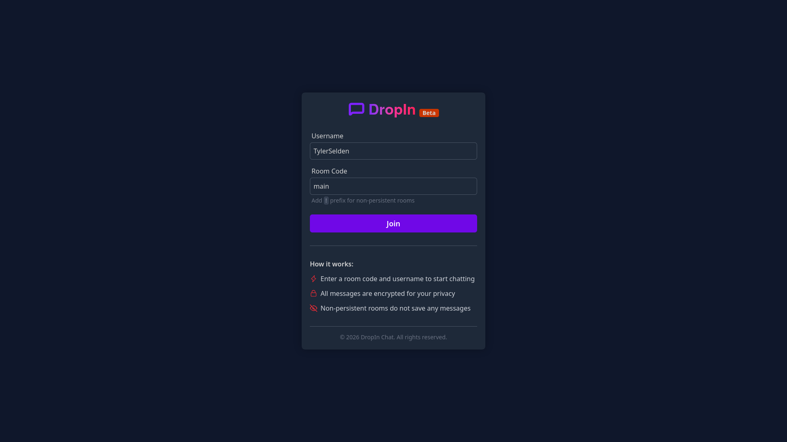
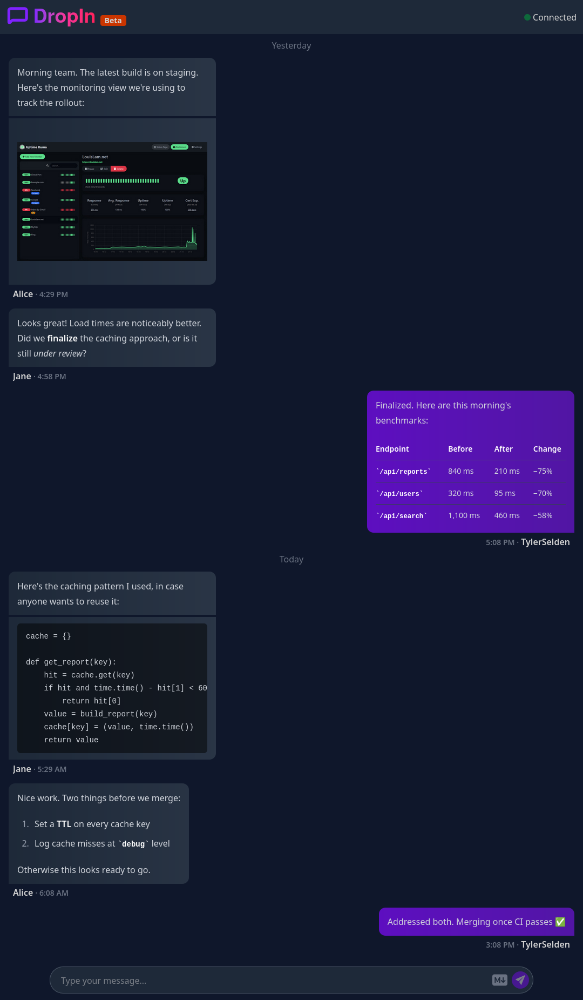

# DropIn 4

DropIn is a free, simple, easy-to-use chat service that prioritizes security and simplicity. It requires only a room code and username to start chatting, with no account necessary. It's designed to be easy to set up, configure, and use.

## Screenshots





## Features

What makes DropIn unique?

- **No Account Required:** DropIn only requires a room code and username to start chatting.
- **No Tracking or Analytics:** DropIn does not track users or collect analytics, helping protect user privacy.
- **Non-Persistent Rooms Available:** When joining a room, simply prefix the room code with `!` to tell the server not to save any messages.
- **Full Markdown Support:** When sending messages, you can write and preview Markdown, including images, links, and more.
- **100% Free and Open Source:** DropIn is and always will be free and open source.
- **Built-in SQLite Database:** DropIn includes its own built-in database, making it quick and easy to host.
- **Easy to Set Up and Maintain:** Build and start DropIn in just a few commands.

## Setup

### Native Deployment

**Prerequisites:**

- Node.js 22.23 or newer
- NPM 10.9 or newer
- Build tools (for native modules)

The easiest way to install these is through `nvm` and `apt`:

```bash
nvm install 22
nvm use 22

sudo apt-get update && sudo apt-get install -y python3 make g++
```

**Installation:**

1. Clone the repository:

```bash
git clone https://github.com/TylerSelden/dropin4
cd dropin4
```

2. Install dependencies:

```bash
npm ci
```

3. Set up `.env` (see [Configuration](#configuration) below):

```bash
cp .env.example .env
```

Edit `.env` to customize DropIn's configuration.

4. Build the frontend:

```bash
npm run build
```

5. Start DropIn:

```bash
npm start
```

**Running in Development:**

1. Set up `.env.development` (see [Configuration](#configuration) below):

```bash
cp .env.development.example .env.development
```

Edit `.env.development` to customize DropIn's development configuration.

2. Start the development server:

```bash
npm run dev
```

This uses `.env.development` and serves the frontend and backend simultaneously, so there's no need to rebuild the frontend.

### Docker Deployment (Recommended)

**Prerequisites:**

- Docker 20.10 or newer
- Docker Compose v2 (optional but recommended)

**Docker Command:**

1. Set up `.env` (see [Configuration](#configuration) below):

```bash
cp .env.example .env
```

2. Build the image:

```bash
docker build -t dropin .
```

3. Run the container:

```bash
docker run -d \
  --name dropin \
  -p 8080:8080 \
  --env-file .env \
  -v ./docker-data:/app/backend/secrets \
  --restart unless-stopped \
  dropin
```

4. Updating to a newer version:

```bash
git pull
docker build -t dropin .
docker rm -f dropin
```

After rebuilding, recreate the container using the `docker run` command above.

**Docker Compose (Recommended):**

1. First run:

```bash
docker compose up -d --build
```

2. Subsequent runs:

```bash
docker compose up -d
```

3. Updating to a newer version:

```bash
git pull
docker compose up -d --build
```

## Configuration

For normal usage, DropIn uses `.env`. In development, it uses `.env.development`. Both files support the same options:

- **`NODE_ENV` (production|development):** Specifies the environment DropIn is running in.
- **`PORT` (1-65535):** The port DropIn listens on (`8080` is recommended for Docker deployments).
- **`VITE_SOCKET_URL` ([URL]):** The base URL that DropIn will be served on.
- **`DB_LOG_LEVEL` (debug|info|warn|error):** Sets the database logging level.
- **`CONSOLE_LOG_LEVEL` (debug|info|warn|error):** Sets the console logging level.
- **`PAGE_SIZE` (>0):** Maximum number of messages returned in a single page request.
- **`MESSAGE_PRUNING_STRATEGY` (age|count|none):** Determines the maximum retention strategy for messages in the database.
- **`MESSAGE_PRUNING_LIMIT` (>0):** Maximum age (in days) or number of old messages to retain, depending on the pruning strategy.
- **`LOG_PRUNING_STRATEGY` (age|count|none):** Determines the maximum retention strategy for logs in the database.
- **`LOG_PRUNING_LIMIT` (>0):** Maximum age (in days) or number of old logs to retain, depending on the pruning strategy.
- **`DB_CLEANUP_INTERVAL` (>0):** How often (in hours) the database is cleaned up by removing old messages and logs.
